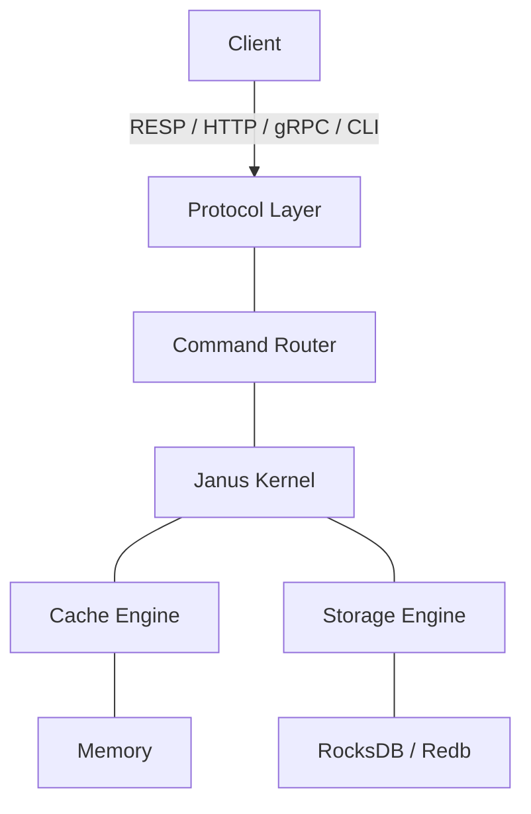
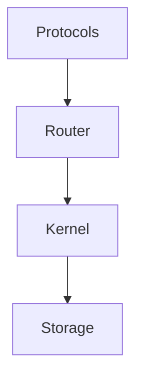
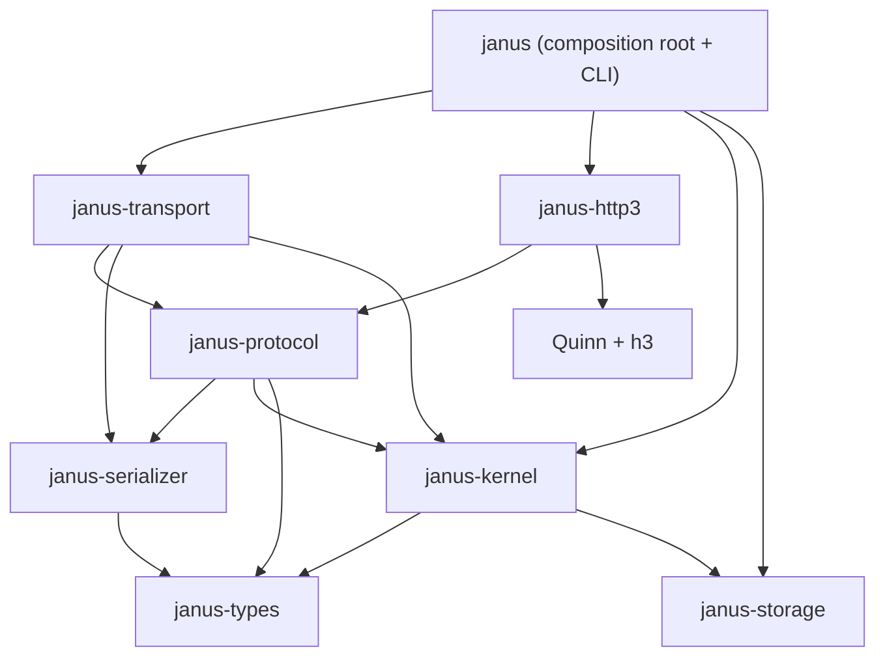
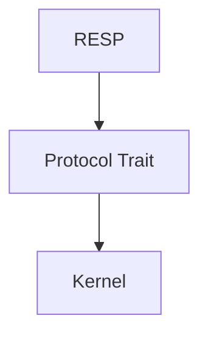
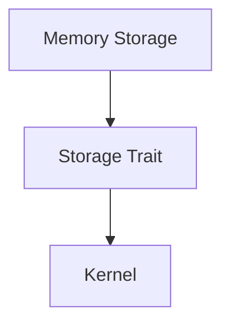
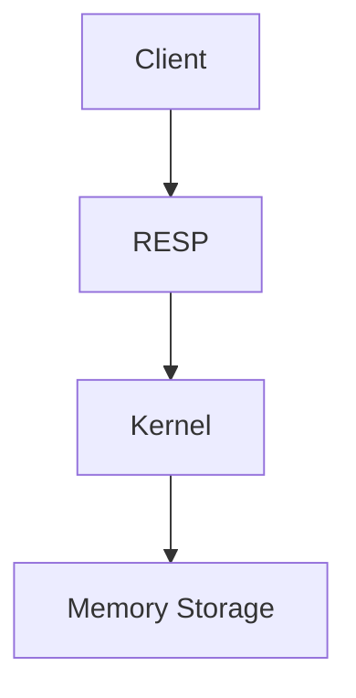

# Architecture

> Janus is designed as a layered and modular data kernel.

# High-Level Architecture

# Layer Responsibilities

## Client Layer

Clients are external applications interacting with Janus.

Examples:

- Redis clients (RESP)
- HTTP clients
- gRPC clients
- CLI tools

Clients never communicate directly with the storage engine.

## Protocol Layer

Responsible for translating external protocols into internal commands.

The root library exposes `listen_with_protocol` and `serve_with_protocol` for
callers that need a custom protocol/serializer composition. The supplied
factory creates one `Protocol` instance for each accepted TCP connection and
receives the server's shared Kernel. `listen` and `serve` keep RESP as their
default; the command-line server remains TCP + RESP. The transport provided by
Janus is TCP, and protocol selection or negotiation is not performed at runtime.

An experimental, library-only `janus-http3` crate provides a separate HTTP/3
edge over Quinn. Its caller supplies certificate material to `bind`; the
endpoint is restricted to ALPN `h3` and TLS 1.3, with 0-RTT disabled. The root
library's `serve_with_http3` runs the existing TCP/RESP listener and HTTP/3
endpoint against one shared Kernel. The CLI and default server remain TCP + RESP.

The optional `janus-capnp-rpc` crate provides a Cap'n Proto RPC Level 1
two-party TCP edge behind the root Cargo feature `capnp`. Each accepted
connection bootstraps a `Janus` capability whose `execute` method maps the
existing domain commands and responses to the same shared Kernel. RESP remains
the default; the CLI can select Cap'n Proto alone or both protocols on
separate listeners. The schema compiler is required only when the feature is
enabled during a build.

The optional `janus-grpc` crate exposes the command surface as a bidirectional
gRPC session over HTTP/2. Each stream owns its authentication role and routes
commands through the same shared Kernel. The CLI can bind gRPC alone, with
RESP, or with the other protocol listeners.

The optional `janus-rest` crate serves the HTTP route adapter over HTTP/1.1.
It maps the key, TTL, persistence, transaction, metrics, tracing, and
authentication operations to REST routes and uses the shared Kernel.

Examples:

- RESP parser
- HTTP API
- gRPC service

Protocols should never execute business logic.

## Command Router

Receives normalized commands from protocol implementations and forwards them to the kernel.

This layer isolates protocol-specific behavior from execution.

## Kernel

The kernel is the heart of Janus.

It coordinates every operation without depending on specific storage implementations.

Responsibilities include:

- command execution
- validation
- lifecycle
- event dispatching
- plugin orchestration

The kernel does not know whether data is stored in memory, disk or a remote system.

## Cache Engine

Responsible for:

- TTL
- eviction
- cache policies
- expiration

Initially only an in-memory implementation will exist.

Future implementations may support:

- TinyLFU
- LRU
- LFU

## Storage Engine

Responsible for reading and writing data.

The storage engine exposes a stable interface while allowing multiple implementations.

Possible implementations:

- Memory
- RocksDB
- Redb
- Sled
- Custom storage

## Persistence Layer

Responsible for durable storage.

Possible implementations include:

- Snapshots
- Write-Ahead Log (WAL)
- Append Only File (AOF)

Persistence should remain independent from networking and protocols.

# Core Design Principles

Every layer should have one responsibility.

Every dependency should point downward.

Lower layers must never depend on upper layers.

Communication should happen through abstractions instead of concrete implementations.

# Crate Map

Each layer lives in its own crate of the Cargo workspace, so the dependency direction is checked by the compiler instead of by convention.

| Crate | Responsibility | Depends on |
| --- | --- | --- |
| `janus-types` | Domain `Command` and `Response` | — |
| `janus-storage` | `StorageEngine` trait, Memory and BTree engines, clock, snapshot codec and store, WAL | — |
| `janus-kernel` | Command execution, transactions, metrics, traces, authentication and roles, replication sinks | `janus-types`, `janus-storage` |
| `janus-serializer` | `Serializer` trait and RESP codec | `janus-types` |
| `janus-protocol` | `Protocol` trait, RESP instance, and HTTP key/value adapter | `janus-types`, `janus-serializer`, `janus-kernel`, `http` |
| `janus-transport` | Tokio TCP accept loop and connection instance; receives an already composed `Arc<Mutex<Kernel>>` | `janus-protocol`, `janus-serializer`, `janus-kernel` |
| `janus-http3` | Optional HTTP/3 server edge over caller-configured Quinn endpoint | `janus-protocol`, `h3`, `h3-quinn`, `quinn`, `rustls`, Tokio |
| `janus-capnp-rpc` | Optional Cap'n Proto RPC edge with one root capability per TCP connection | `janus-protocol`, `janus-kernel`, `capnp`, `capnp-rpc`, Tokio |
| `janus-grpc` | Optional bidirectional gRPC session edge using Protocol Buffers | `janus-protocol`, `janus-kernel`, `tonic`, `prost`, Tokio |
| `janus-rest` | Optional HTTP/1.1 REST listener | `janus-protocol`, `janus-kernel`, Hyper, Tokio |
| `janus` | Composition root (`build_storage`, `build_kernel`, `listen`, `serve`, `serve_with_http3`, optional RPC/REST compositions) and CLI binary | `janus-transport`, `janus-http3`, optional `janus-capnp-rpc` / `janus-grpc` / `janus-rest`, `janus-protocol`, `janus-kernel`, `janus-storage`, Tokio |

Rules:

- Lower crates never depend on upper crates; `janus-types` and `janus-storage` have no internal dependencies.
- The transport never sees storage, snapshots or the WAL; persistence is wired only in the composition root.
- `janus-transport`, `janus-http3` and the root package depend on Tokio. Kernel, protocol and serializer stay synchronous.
- HTTP/3 remains an opt-in library edge; RESP remains the default CLI mode.
- Cap'n Proto RPC remains optional; RESP is the default mode, while `capnp` and `both` use a dedicated TCP listener and the same Kernel.
- gRPC remains optional; RESP is the default mode, while `grpc`, `resp+grpc`, and `all` use a dedicated gRPC listener and the same Kernel.
- REST remains optional; RESP is the default mode, while `rest`, `resp+rest`, and `all` use a dedicated HTTP/1.1 listener and the same Kernel.
- Tests that need an upper layer use dev-dependencies (for example, serializer tests that drive the Kernel), which do not change the production graph.

# Modularity

Every subsystem should be independently replaceable.

Examples:

or

No subsystem should require modifications in unrelated modules.

# Future Architecture

Future versions may introduce additional layers.

Examples:

- Replication
- Cluster management
- Transactions
- Metrics
- Tracing
- Plugin system
- Security
- Authentication

These components should integrate with existing abstractions instead of changing the kernel.

# Initial Scope

The first milestone intentionally keeps the architecture small.

Only after validating the architecture will additional modules be introduced.

The objective is to evolve the architecture incrementally while maintaining simplicity.
