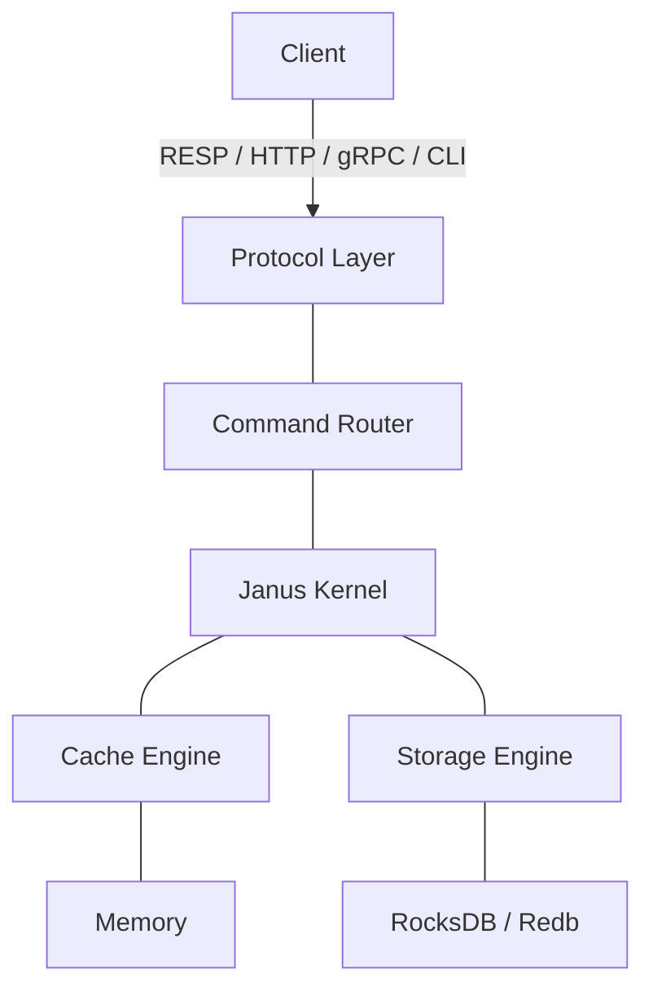
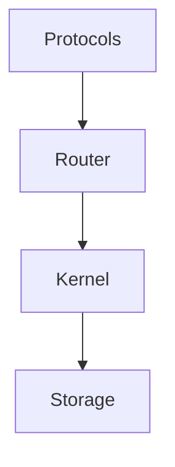
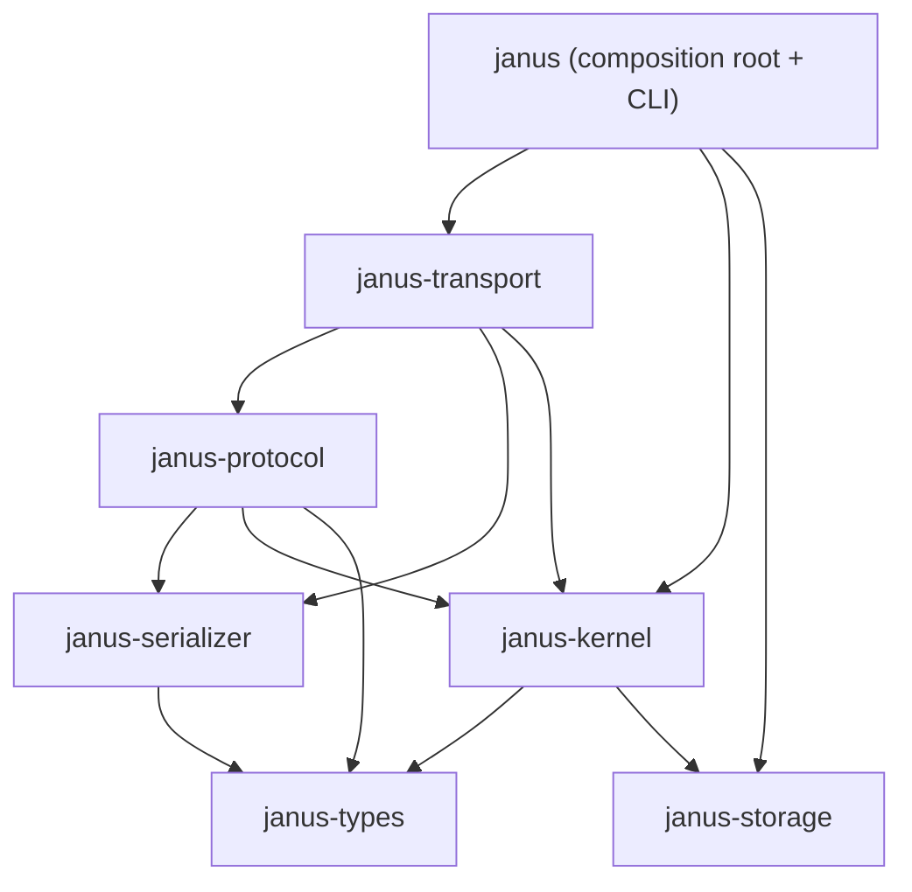
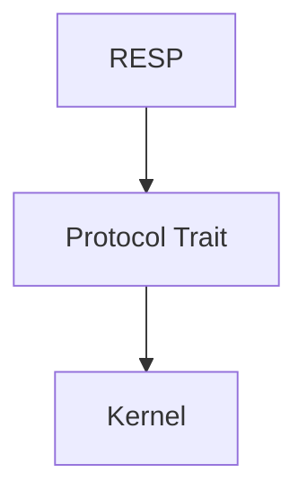
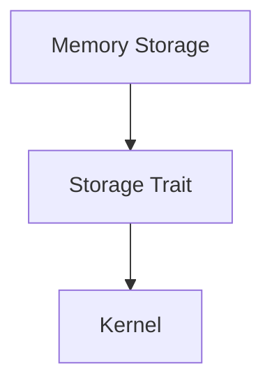
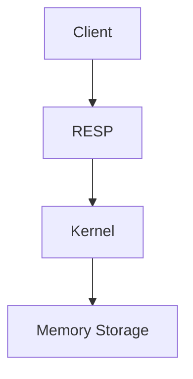

# Architecture

> Janus is designed as a layered and modular data kernel.

# High-Level Architecture

# Layer Responsibilities

## Client Layer

Clients are external applications interacting with Janus.

Examples:

- Redis clients (RESP)
- HTTP clients
- gRPC clients
- CLI tools

Clients never communicate directly with the storage engine.

## Protocol Layer

Responsible for translating external protocols into internal commands.

Examples:

- RESP parser
- HTTP API
- gRPC service

Protocols should never execute business logic.

## Command Router

Receives normalized commands from protocol implementations and forwards them to the kernel.

This layer isolates protocol-specific behavior from execution.

## Kernel

The kernel is the heart of Janus.

It coordinates every operation without depending on specific storage implementations.

Responsibilities include:

- command execution
- validation
- lifecycle
- event dispatching
- plugin orchestration

The kernel does not know whether data is stored in memory, disk or a remote system.

## Cache Engine

Responsible for:

- TTL
- eviction
- cache policies
- expiration

Initially only an in-memory implementation will exist.

Future implementations may support:

- TinyLFU
- LRU
- LFU

## Storage Engine

Responsible for reading and writing data.

The storage engine exposes a stable interface while allowing multiple implementations.

Possible implementations:

- Memory
- RocksDB
- Redb
- Sled
- Custom storage

## Persistence Layer

Responsible for durable storage.

Possible implementations include:

- Snapshots
- Write-Ahead Log (WAL)
- Append Only File (AOF)

Persistence should remain independent from networking and protocols.

# Core Design Principles

Every layer should have one responsibility.

Every dependency should point downward.

Lower layers must never depend on upper layers.

Communication should happen through abstractions instead of concrete implementations.

# Crate Map

Each layer lives in its own crate of the Cargo workspace, so the dependency direction is checked by the compiler instead of by convention.

| Crate | Responsibility | Depends on |
| --- | --- | --- |
| `janus-types` | Domain `Command` and `Response` | — |
| `janus-storage` | `StorageEngine` trait, Memory and BTree engines, clock, snapshot codec and store, WAL | — |
| `janus-kernel` | Command execution, transactions, metrics, traces, authentication and roles, replication sinks | `janus-types`, `janus-storage` |
| `janus-serializer` | `Serializer` trait and RESP codec | `janus-types` |
| `janus-protocol` | `Protocol` trait and the per-connection RESP instance (auth / role gate, MULTI queue) | `janus-types`, `janus-serializer`, `janus-kernel` |
| `janus-transport` | Tokio TCP accept loop and connection instance; receives an already composed `Arc<Mutex<Kernel>>` | `janus-protocol`, `janus-serializer`, `janus-kernel` |
| `janus` | Composition root (`build_storage`, `build_kernel`, `listen`, `serve`) and CLI binary | `janus-transport`, `janus-kernel`, `janus-storage` |

Rules:

- Lower crates never depend on upper crates; `janus-types` and `janus-storage` have no internal dependencies.
- The transport never sees storage, snapshots or the WAL; persistence is wired only in the composition root.
- Only `janus-transport` and the root package depend on Tokio. Kernel, protocol and serializer stay synchronous.
- Tests that need an upper layer use dev-dependencies (for example, serializer tests that drive the Kernel), which do not change the production graph.

# Modularity

Every subsystem should be independently replaceable.

Examples:

or

No subsystem should require modifications in unrelated modules.

# Future Architecture

Future versions may introduce additional layers.

Examples:

- Replication
- Cluster management
- Transactions
- Metrics
- Tracing
- Plugin system
- Security
- Authentication

These components should integrate with existing abstractions instead of changing the kernel.

# Initial Scope

The first milestone intentionally keeps the architecture small.

Only after validating the architecture will additional modules be introduced.

The objective is to evolve the architecture incrementally while maintaining simplicity.